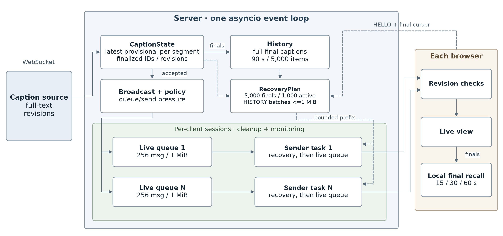

# LiveRecall — CS3103 Assignment 4

LiveRecall displays revision-based lecture captions, supports local 15/30/60-second
recall, and recovers recent finals after reconnecting or joining late. The mandatory
path uses the supplied deterministic caption source, not an ASR service.

## Architecture

```text
caption_source.py → solution_server.py → per-client queue/sender → browser
                         ├─ revision state + active provisional snapshots
                         ├─ bounded final history
                         └─ per-client monitoring + overload policy
```



- `captions/` validates revisions, locks finals and retains recent context.
- `delivery/` supplies bounded queues, senders, cleanup, monitoring and overload modes.
- `client/` renders segment updates, merges HISTORY and stores local recall.
- Lecture state is in memory and is lost on server restart.
- Editable diagrams and code-grounded descriptions: [report material](docs/report/architecture_and_recovery.md).

## Ubuntu setup

Validated environment: Ubuntu 24.04.4 ARM64, Python 3.12.3, websockets 16.1.1.
The required server path has no cloud/database dependency.

```bash
sudo apt update
sudo apt install -y python3 python3-venv python3-pip iproute2
python3 -m venv venv
source venv/bin/activate
pip install -r requirements.txt
python submission_check.py
```

See [UBUNTU_SETUP.md](UBUNTU_SETUP.md). Optional `bonus_asr/` dependencies are
separate from mandatory evaluation.

## Run the application

Open three terminals at the repository root and activate the environment in each:

```bash
# 1. WebSocket server
python solution_server.py --port 8765

# 2. Browser files: open http://127.0.0.1:8000
python -m http.server 8000 --directory client

# 3. Deterministic captions
python caption_source.py --uri ws://127.0.0.1:8765 --duration 120
```

The browser endpoint is currently `ws://127.0.0.1:8765` in `client/app.js`.
If changing the server host/port, update this endpoint or use port forwarding.
On Windows, invoke the existing environment directly with
`.\.venv\Scripts\python.exe solution_server.py --port 8765`.

## Configuration

| Option | Environment fallback | Default |
| --- | --- | --- |
| `--queue-max-messages` | `LIVERECALL_QUEUE_MAX_MESSAGES` | 256/client |
| `--queue-max-bytes` | `LIVERECALL_QUEUE_MAX_BYTES` | 1048576 payload bytes/client |
| `--send-timeout` | `LIVERECALL_SEND_TIMEOUT` | 10 s |
| `--close-timeout` | `LIVERECALL_CLOSE_TIMEOUT` | 3 s |
| `--keepalive-interval` | `LIVERECALL_KEEPALIVE_INTERVAL` | 2 s |
| `--keepalive-timeout` | `LIVERECALL_KEEPALIVE_TIMEOUT` | 5 s |

- CLI overrides environment values. Startup prints effective settings.
- `--naive` disables proactive degraded-mode selection; queue-full fallback remains.
- `--experiment-send-delay-ms` adds artificial sender delay for experiments only,
  defaults to zero, and does not model actual network impairment.
- Queue caps exclude in-flight payloads, Python overhead and transport/kernel buffers.
- `python solution_server.py --help` lists all supported options.

## Delivery and recovery

- Normal mode forwards accepted revisions. Per-client policy uses queue pressure
  and send/queue age with separate entry/exit thresholds.
- Overload cleanup removes provisional revisions only when a higher revision of
  the same segment is queued or being admitted. It preserves each active
  segment's latest version, including when segments interleave.
- Unresolved admission failure closes the client with 1013. Pong timeout can also
  close it; this does not precisely measure displayed-caption lag.
- Reconnect reports the last accepted final cursor. The server queues missing
  recent finals, then current provisional snapshots, before live updates.
- History is bounded to 90 s/5,000 items. Recovery requests are capped at 60 s;
  selected retained finals are streamed in HISTORY batches of at most 1 MiB,
  followed by active snapshots and queued live updates. Expired/count-pruned
  history and individually oversized messages remain limitations.
- Browser caption state/cursor are page-local; refresh resets them. sessionStorage
  currently retains only the client ID. Normal recall reads local finals.

## Tests and experiments

```bash
python -m unittest discover -s tests -t . -v

# Official T3: three independent slow-reader runs
python run_demo.py --clients 100 --duration 60 --runs 3 \
  --slow-percent 10 --slow-ms 500 --output-stem t3
```

Use `-t .` so test packages do not shadow application packages. The recovery
export passed 141 tests on Ubuntu and Windows. These tests do not replace
public networking measurements or browser validation.

- [PUBLIC_TESTS.md](PUBLIC_TESTS.md): T1–T5 commands and repetition.
- [tests/README.md](tests/README.md): test groups and scope.
- [3 November evidence](experiments/delivery_20261103/README.md): immutable versions,
  raw outputs, RSS traces, plots, methods and limitations.
- [Recovery rerun evidence](experiments/recovery_batches/README.md): current
  T1–T5 reruns, complete-state recovery checks, source hashes and updated plots.

T3 before/after evidence shows 100% normal-client coverage/completeness, with slow
final completeness improving from 51.32% to 100% at the cutoff. Slow freshness
remains poor and reconnect events are nonzero. RSS increased during the five-minute
observation; no leak-free or long-term memory-bound claim is made.

T1, T2, T4 and T5 also have three recorded runs each. All reached 100% final
completeness. Under T5 delay/loss, P99 live age was 1002.58 ms and freshness 89.12%.
T5 used an isolated network namespace; the host loopback qdisc remained unchanged.

## Submission documents

- [Report PDF](report.pdf): current draft snapshot; update it as the team refines the report.
- [Shared report](https://docs.google.com/document/d/12Bg3ZvpDkxkNV6cptI7mkXdj6YwLh6GLxcDzwSs-w_4): editable report; re-export `report.pdf` after changes.
- [AI_USAGE.md](AI_USAGE.md): documented AI assistance and a corrected design example.
- [CONTRIBUTIONS.md](CONTRIBUTIONS.md): responsibilities; percentages need team agreement.
- [Project checklist](docs/project_checklist.md): functionality and deliverables.
- [Delivery guide](docs/delivery/client_delivery.md): interfaces and lifecycle.

The final submission also requires the separate 5–7 minute demo video. The report
must be 4–5 pages excluding references/appendices. Run `python submission_check.py --final`
once the final documents exist. The handout is excluded from Git; `report.pdf`
remains trackable.
