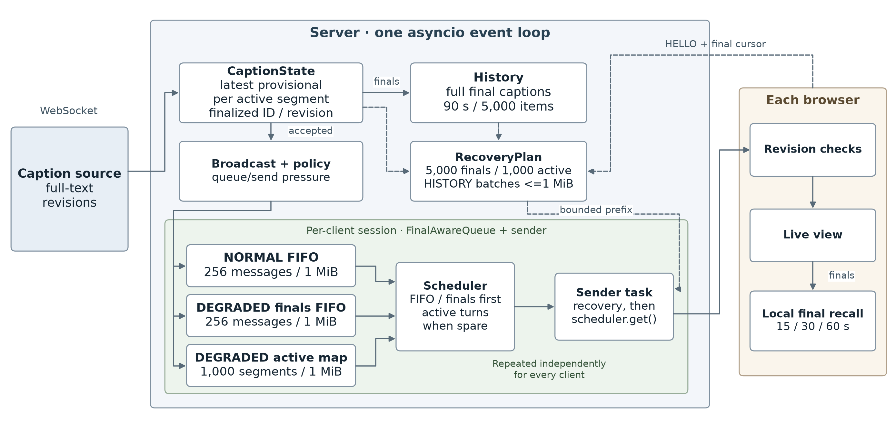
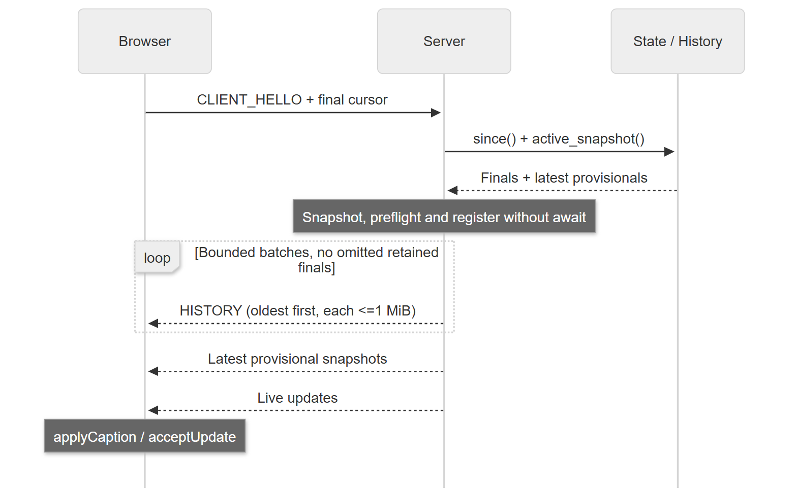

# Architecture, Protocol and Recovery

Code-grounded report material for final-aware export `f115f048f59d`.

## 1.1 System Architecture

The supplied caption_source.py emits full-text revisions over WebSocket. One asyncio server routes connections by their hello message. CaptionState retains active/latest revisions and finalized IDs; History retains recent finals. Each client owns a FinalAwareQueue, sender and supervised session. NORMAL uses FIFO; DEGRADED separates final/control FIFO and latest-active map, with a final-aware scheduler. RecoveryPlan supplies a bounded prefix before live delivery. The browser maintains display and recall state; lecture state is lost on server restart.

Figure 1. `CaptionState` retains latest active provisionals and finalized IDs/revisions; `History` retains full finals. Each client uses NORMAL FIFO or DEGRADED final/control FIFO plus latest-active map. A final-aware scheduler feeds its sender; RecoveryPlan supplies a bounded initial prefix. Modes are exclusive; dashed paths show recovery/control.

## 1.2 Application Protocol

Messages are JSON text frames. SOURCE_HELLO identifies a source; CLIENT_HELLO supplies client_id, session, the last accepted final segment/revision and a requested history window. CAPTION_UPDATE carries session, segment, revision, source_ts, final and the complete text for that revision. HISTORY contains an oldest-first array of finalized CAPTION_UPDATE objects. Recovery may use multiple oldest-first HISTORY batches following CLIENT_HELLO; they precede active snapshots and later live updates. No unsolicited HISTORY is used for ordinary live delivery. SOURCE_DONE reports source completion for diagnostics. Hello/session fields route traffic; they do not provide authentication or independent multi-lecture state.

## 2.1 Revision State and Bounded History

The server accepts an active segment only at a strictly newer revision and rejects all changes after finalization. The browser independently applies equivalent revision/final rules. Server state caps active segments at 1,000 and remembered final revisions at 10,000; a segment watermark rejects forgotten ranges. Full finals are retained separately for 90 seconds and at most 5,000 items. Retention uses server monotonic acceptance time, with pruning on insertion/query. Count limits can shorten retained context under high load. Transmission batching avoids omitting retained finals just because their combined size exceeds one message.

## 2.2 Local Recall and Browser Behavior

Live and recovered captions share applyCaption()/acceptUpdate(), so accepted revisions replace one segment line rather than adding duplicates. Provisional and final styling differs. The browser tracks at most 2,000 segments and renders at most 300 lines, with follow-live scrolling and a jump control. Accepted finals enter a local rolling recall store, filtered by source timestamps: default 30 seconds, selectable 15/30/60 seconds. Normal recall reads this store without a server request. This timestamp comparison assumes synchronized source/browser clocks.

## 2.3 Reconnect and Late-Join Recovery

After closure, the browser retries after three seconds and reports its latest accepted final cursor; a fresh page sends 0/0. Caption state is page-local; sessionStorage preserves only the client ID. The server validates the request, caps its window at 60 seconds, and snapshots all selected retained finals plus latest active updates without yielding before registration. RecoveryPlan preflights individual messages and splits finals into HISTORY batches, each at most min(queue byte limit, 1 MiB). The sender streams batches, then active snapshots, before consuming the bounded live queue. The plan shares at most 5,000 final and 1,000 active strings and builds one batch at a time. Oversized individual messages fail before partial delivery. Retention/count limits, disconnects and live-queue overflow remain limits.

Figure 2. The sender streams bounded HISTORY batches and active snapshots before consuming the live FIFO. Snapshot and registration have no intervening await.

## Code locations

| Concern | Implementation |
| --- | --- |
| Connection routing and initial batch | `solution_server.py`: `handler`, `handle_source`, `handle_client` |
| Authoritative revisions | `captions/state.py`: `apply`, `_decide`, `active_snapshot` |
| Final recovery selection | `captions/history.py`: `add`, `prune`, `since`, `history_message` |
| Local display and recall | `client/app.js`: `acceptUpdate`, `applyCaption`, `getMissedCaptionsSince` |
| Queue, send and teardown | `delivery/client_queue.py`, `client_sender.py`, `client_session.py` |
