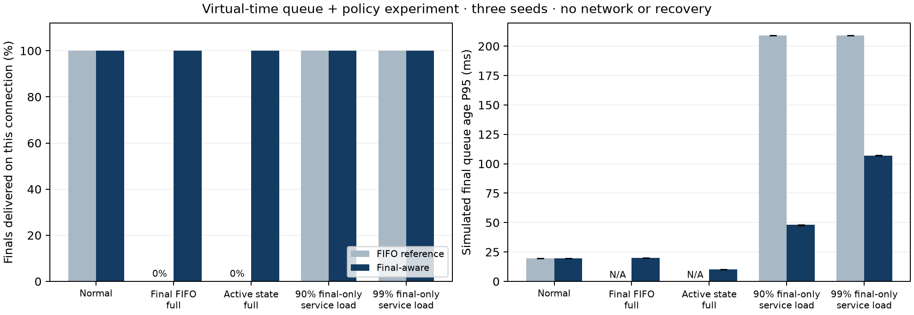
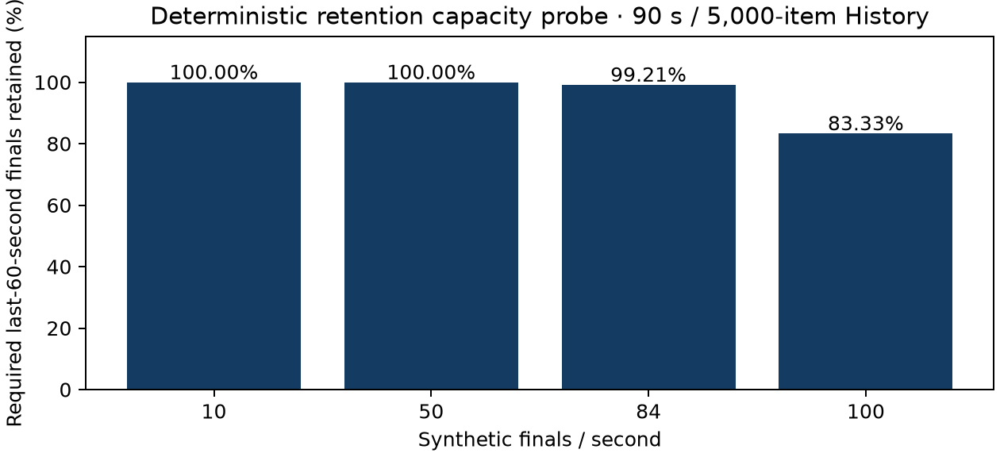

# Final-aware delivery validation

The server now uses `FinalAwareQueue`: NORMAL preserves full FIFO revisions;
DEGRADED separates a protected final/control FIFO and latest-active map. Only
one mode is populated at a time. The exact tested source is export
`f115f048f59d`, parent commit `41c208b`.

## Design and bounds

- NORMAL: 256 messages / 1 MiB FIFO.
- DEGRADED: final/control FIFO 256 messages / 1 MiB; active map 1,000 segments /
  1 MiB. New provisionals cannot consume final-lane capacity and vice versa.
- Maximum pending live payloads: 1,256 items / 2 MiB. This excludes Python
  overhead, one in-flight payload, socket buffers and bounded recovery references.
- Keep only the highest queued/incoming provisional revision per segment.
  A newer final removes its segment's provisional; other active latest state remains.
- Low final pressure normally allows an active turn after four protected sends.
  A final backlog of at least min(4, final FIFO capacity) overrides that share.
  A fixed 4:1 split alone would limit final throughput to 80%, even when the
  receiver could carry a 90% or 99% final-only load.
- Active replacements retain their service turn. Returning to NORMAL restores
  retained arrival order only when the backlog plus new item fits the FIFO.
- Both lanes have hard limits. Admission failure is atomic; exhaustion can still
  trigger server eviction. No unconditional final-delivery guarantee is claimed.

## Controlled queue experiment

This is a deterministic virtual-time application queue/policy experiment, not
network latency or a modified public benchmark. It runs five cases, two queue
implementations and three source seeds (30 cases total). The FIFO reference uses
the original ClientQueue admission behavior; the priority variant uses production
FinalAwareQueue. Reconnect/HISTORY and in-flight/TCP buffers are not modeled.

- Normal: five finals/s plus ten provisional updates/s; service 100 messages/s.
- Full finals: two queued finals, then an unrelated provisional, queue capacity 2.
- Full active: 32 latest active segments, then an unrelated final, FIFO capacity 32.
- Near capacity: 90 or 99 finals/s plus 40 provisional updates/s across eight active
  segments, service 100 messages/s. Source runs 20 s; allow 2 s to drain.
- Default controlled FIFO limit is 32 messages/64 KiB. Priority retains that final
  budget and adds an active map capped at 1,000 segments/64 KiB. The capacity gain
  is intentional: this compares storage and scheduling together, not priority alone.
- Failed admission models connection eviction and discards its backlog. The zero
  delivery outcomes below do not model the server's later reconnect recovery.

| Case | FIFO finals delivered | Final-aware finals delivered | FIFO final queue-age P95 | Final-aware P95 |
|---|---:|---:|---:|---:|
| Normal | 100% | 100% | 19.63 ms | 19.63 ms |
| Full final FIFO | 0% | 100% | N/A (evicted) | 20.00 ms |
| Full active state | 0% | 100% | N/A (evicted) | 10.00 ms |
| 90% final-only service load | 100% | 100% | 209.13 ms | 48.02 ms |
| 99% final-only service load | 100% | 100% | 208.97 ms | 107.07 ms |

Every priority case ends with every required latest active state present and no
eviction. Normal Update Coverage is 100% in the normal case. Lane counts/bytes
are checked on every accepted admission. Numbers are medians across three seeds;
they are not measured Caption Age over a network.



## History capacity diagnostic

This is a separate deterministic capacity probe; History retention policy is
unchanged. Inject accepted final Events over 90 virtual seconds, then request the
last 60 seconds. The 5,000-item cap retains all 600/3,000 required finals at 10/50
finals/s, but only 5,000 of 5,040 at 84/s and 5,000 of 6,000 at 100/s.

The result demonstrates that a nominal 90-second window does not guarantee full
60-second retention at every source rate. It is not a network throughput test,
and no claim is made about the undisclosed hidden-test rate. Capacity/retention
changes remain separate work.



## Reproduce

```powershell
.venv/Scripts/python.exe experiments/final_aware_delivery/run_comparison.py
.venv/Scripts/python.exe -m pip install matplotlib
.venv/Scripts/python.exe experiments/final_aware_delivery/plot_comparison.py
```

## Public and recovery reruns

- Exact source export: `41c208b+final-aware-working-f115f048f59d`.
- GB10: Ubuntu 24.04.4, ARM64, 20 logical CPUs, Python 3.12.3,
  websockets 16.1.1. All experiments use the same exclusive lock.
- Unchanged instructor source/runner/clients/analyser; seed 3103 and a fresh
  server per run. Each public workload ran three times. Values below are medians.
- T1: 20 clients/20 s; T2: 100/40 s; T3: 100/60 s with 10 readers waiting
  500 ms per receive; T4: 100/60 s, 20% offline at 15 s for 5 s.
- T1–T4 use loopback without impairment. T5 uses 100 clients/40 s in an
  isolated namespace: 120 ms ±30 ms normal jitter and 3% loss on loopback.
  Source/server and server/client paths both traverse it. Host qdisc was
  checked after completion: `noqueue`.

| Test | P50 / P95 / P99 Caption Age (ms) | Fresh updates | Fresh finals | Final completeness | Normal Update Coverage |
|---|---|---:|---:|---:|---:|
| T1 | 1.34 / 1.97 / 2.25 | 100% | 100% | 100% | 100% |
| T2 | 3.10 / 4.17 / 4.44 | 100% | 100% | 100% | 100% |
| T4 | 3.94 / 5.95 / 6.75 | 100% | 98.42% | 100% | 98.25% |
| T5 | 256.97 / 703.92 / 978.55 | 87.36% | 86.94% | 100% | 99.98% |

Fresh means ≤500 ms. Caption Age excludes browser UI and HISTORY items;
final completeness includes recovery. T4 HISTORY-response P95 is 3.46 ms,
not the full-state recovery time. All runs have zero duplicate/stale captions;
T1/T2/T4/T5 have zero connection errors.

T3 normal clients retain 100% coverage/final completeness and P95 5.66 ms.
Slow readers have P95 13.36 s, 2.65% fresh updates, 1.32% fresh finals,
49.56% live coverage and 100% final completeness. There are still 20 connection
errors and 380 recovered items per run. The public slow-reader result did not
materially improve over the preceding batched-recovery version; this workload
does not isolate the new queue's behavior. Comparison against historical
`acef9a3` changes whole versions and measurement populations.

The independent recovery oracle verifies all required finals/latest active
payloads in 15/15 runs, including approximately 1.9 MiB split across two HISTORY
batches, 300 active segments and a one-slot live queue. Large-history median
complete recovery is 17.03 ms. `before.json` is the historical pre-batching
`18f0dbf`; it is not the immediate parent of this scheduler change.

Supplementary RSS: three T3 peaks are 33.54–33.63 MiB. A separate 300 s workload
has a 308.9 s sampled trace including startup/teardown: peak 36.66 MiB, early/late
medians 32.35/36.63 MiB, post-60 s slope 0.72 MiB/min. This does not establish
a plateau or identify a memory leak. It excludes client and kernel memory.

## Retained artifacts

- `accepted-evidence.tar.gz`: all accepted CSV/JSON, logs, RSS samples, host
  metadata, exact tested source export and runner scripts. Expanded `evidence/`
  is ignored. No redundant per-run archives are needed.
- `comparison.json`, `current.json`, `public_summary.json`, `memory_summary.json`:
  controlled, oracle, public and RSS summaries. PNGs are generated from these
  records and the archive's CSV files.
- `SHA256SUMS.json` and `verify_evidence.py`: validate published checksums,
  exact runtime/test hashes and public medians against archived runs.

```powershell
python experiments/final_aware_delivery/verify_evidence.py
```

For public plots, extract only the archive's `evidence/` members with Python
tarfile's `filter="data"`, run `summarize_runs.py`, then `plot_public.py`.
`plot_recovery.py` redraws the full recovery figure. The archived runner scripts
record the exact public commands; T5 requires Linux network-namespace privileges.
