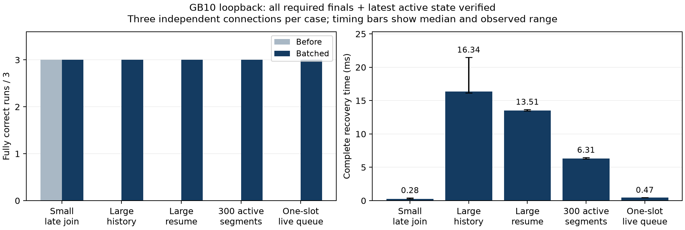

# Bounded recovery verification

## What changed

- Before (`18f0dbf`): one HISTORY response and active updates had to fit together
  in the live queue before session registration. Large context could be truncated
  or rejected even when each individual caption fit the message limit.
- Batched snapshot (`f630bc443b7a`, full source hashes in `current.json`): capture
  selected retained finals and active state, preflight individual messages, then
  send bounded HISTORY batches and active snapshots before the live queue.
- HISTORY remains part of CLIENT_HELLO recovery only. The wire format is unchanged;
  clients merge every HISTORY batch using their existing revision checks.

## Method

- GB10, Ubuntu 24.04.4 ARM64, Python 3.12.3; server and receiver on loopback.
- Five controlled cases, three fresh connections/server instances each version.
  No delay/loss shaping, simulated slow reads or artificial send delay.
- The oracle independently constructs every required final and latest active
  payload. It compares complete payloads, duplicates, missing IDs and ordering.
- Start: successful WebSocket connection, before CLIENT_HELLO transmission.
  Finish: **all required final and active payloads correctly received**.
- First-HISTORY latency is recorded separately. It is not complete recovery time.
- A 3 s per-connection test deadline identifies missing/rejected recovery. Failed
  runs have no completion latency; they are not plotted as zero milliseconds.
- Large history: 96 finals with approximately 20 KB text each plus three active
  segments. Resume excludes 16 finals already held by the receiver.
- Many-active case: ten finals and 300 active segments, exceeding the 256-message
  live queue. One-slot case: ten finals and 16 active segments with queue capacity 1.
- These are additional controlled correctness experiments, not modified public
  tests, congestion measurements, or a guarantee for every hidden workload.

## Results

| Case | Before correct runs | Batched correct runs | Batched median full recovery | HISTORY batches |
|---|---:|---:|---:|---:|
| Small late join | 3/3 | 3/3 | 0.28 ms | 1 |
| Large history | 0/3 | 3/3 | 16.34 ms | 2 |
| Large resume | 0/3 | 3/3 | 13.51 ms | 2 |
| 300 active segments | 0/3 | 3/3 | 6.31 ms | 1 |
| One-slot live queue | 0/3 | 3/3 | 0.47 ms | 1 |

The before version rejected the four larger/capacity-constrained cases before
delivering context. The batched version recovered every expected item in every
run, with zero duplicates and no missing active state. This fixes the tested
capacity boundary, rather than showing that batching accelerates small recovery.



## Remaining limits

- History still has 90 s/5,000-item retention bounds. Count-pruned or expired
  finals cannot be restored by batching.
- An individual final must fit inside one HISTORY message; individual oversized
  messages are rejected before partial delivery.
- Source updates during the recovery prefix use the separate bounded live queue.
  Live overflow, send timeout and disconnect can still abort recovery.
- No ACK or new completion message is added to the application protocol. Complete
  timing is established by this test's known expected state, not by the browser
  treating the first HISTORY response as a completion signal.

## Reproduce

```powershell
.venv/Scripts/python.exe experiments/recovery_batches/run_validation.py --output tmp/recovery-validation.json
.venv/Scripts/python.exe -m pip install matplotlib
.venv/Scripts/python.exe experiments/recovery_batches/plot_results.py
```

`before.json` and `current.json` retain every run, timing range, platform and source
hash. `run_current.py` separately runs the unchanged public harness on an isolated
Ubuntu export; its public results are recorded separately from this oracle test.

## Public reruns and memory

- `public_summary.json`: three-run medians/min/max for T1–T5; T3 separates normal
  and slow clients. The public tools and their measurement logic were unchanged.
- All current T1–T5 runs reached 100% Final Caption Completeness. T1/T2 retained
  100% Normal Update Coverage. T3 still had 20 connection-error events and 380
  recovered HISTORY items per run; slow-reader Fresh Final Caption Ratio was 1.32%.
- T5 used the supplied delay/loss profile inside an isolated network namespace;
  the host loopback qdisc remained `noqueue`. Its median Fresh Caption Ratio was
  90.76%, Fresh Final Caption Ratio 89.43%, and final completeness 100%.
- `memory_summary.json`: three T3 peak RSS values and one supplementary 300 s
  workload, sampled over 308.9 s including startup/teardown. Early/late median
  RSS was 32.14/36.46 MiB; peak 36.48 MiB. The trace does not establish a plateau
  or diagnose a leak. It does not attribute growth to individual containers.
- Accepted runs used one experiment lock. A mistakenly started old-directory T5
  overlapped initial T4/RSS measurements; those were excluded and repeated.

`accepted-evidence.tar.gz` is the single raw-data package: public CSV/JSON, logs,
RSS traces, host metadata, source manifest, exact tested source export and runners.
Superseded overlapping runs are preserved remotely but are not in this package.
After measurement, `client_recovery.py` received whitespace-only formatting.
`formatting_equivalence.json` records both hashes; the verifier checks that its
Python AST matches the exact tested source inside the archive. Original experiment
hashes and raw results are preserved.
Expanded data is ignored by Git. Extract only its `evidence/` directory to replot:

```bash
cd experiments/recovery_batches
tar -xzf accepted-evidence.tar.gz evidence
```

From the project root:

```powershell
.venv/Scripts/python.exe experiments/recovery_batches/summarize_public.py --evidence experiments/recovery_batches/evidence
.venv/Scripts/python.exe experiments/recovery_batches/plot_public.py
.venv/Scripts/python.exe experiments/recovery_batches/verify_evidence.py
```
